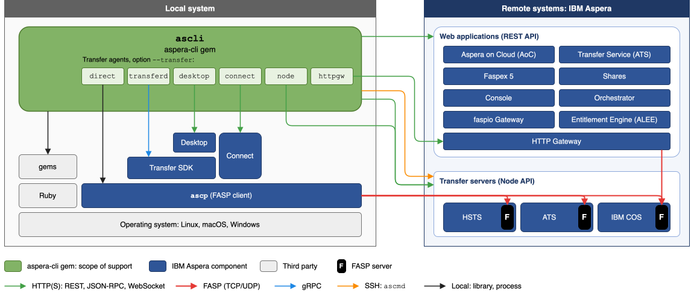

# Architecture Documentation

## Overview

The IBM Aspera CLI (`ascli`) is a Ruby-based command-line interface that provides unified access to IBM Aspera's high-speed file transfer products and services. The architecture follows a modular, plugin-based design that separates concerns between command processing, API communication, and transfer execution.

## System Architecture



The architecture diagram illustrates the layered structure of `ascli` and its interactions with external components.
Source: [`architecture.drawio`](architecture.drawio), exported by `rake doc:diagrams`.

## Architectural Layers

### Local System Layer

The foundation layer consists of the local execution environment:

- **Operating System**: Cross-platform support (Linux, macOS, Windows)
- **Ruby Runtime**: Ruby interpreter, minimum version `RUBY_MINIMUM_VERSION` in [`lib/aspera/cli/info.rb`](../lib/aspera/cli/info.rb) (CI tests: matrix in [`.github/workflows/test.yml`](../.github/workflows/test.yml))
- **Ruby Gems**: Third-party dependencies managed via Bundler
- **Transfer Agents**: Multiple FASP client implementations, selected with option `--transfer`
  - `ascp` (client): The core FASP protocol implementation (`direct`)
  - Transfer SDK (trSDK): gRPC-based transfer daemon (`transferd`)
  - Connect: Browser-based transfer client (`connect`)
  - Desktop: Aspera Desktop Client integration, over JSON-RPC; the client runs the Transfer SDK underneath (`desktop`)
- **`async`** (Aspera Sync): FASP client started by the `sync` commands, see [Async Sync](#async-sync)
- **Remote Transfer Agents**: The transfer runs on a server, see [Remote Systems Layer](#remote-systems-layer)
  - HTTPGW: HTTP Gateway for firewall-friendly transfers (`httpgw`)
  - Node: Direct Node API transfers (`node`)

### Core Application Layer (`aspera-cli` gem)

The central green component in the diagram represents the Ruby gem that implements all CLI functionality.

#### Entry Point

**File**: [`bin/ascli`](../bin/ascli)

The main executable script that:

- Sets up UTF-8 encoding for internationalization
- Pre-parses early logging options before full initialization: `--log-level` / `--log.level`, `--log-format` / `--log.format`, `--logger` / `--log.type`
- Loads optional code coverage (`aspera/coverage`)
- Fixes the home directory on Windows via `Environment.instance.fix_home`
- Delegates to the main CLI processor

```ruby
#!/usr/bin/env ruby
# Pre-parses logging options before full initialization
ARGV.each { |arg| ... }
require 'aspera/coverage'
require 'aspera/environment'
require 'aspera/cli/runner'
Aspera::Environment.instance.fix_home
Aspera::Cli::Runner.new(ARGV).run
```

#### Runner and Context

**Files**: [`lib/aspera/cli/runner.rb`](../lib/aspera/cli/runner.rb), [`lib/aspera/cli/context.rb`](../lib/aspera/cli/context.rb)

The `Runner` class orchestrates the full command lifecycle:

- **`run`**: Main entry point — calls `run_with_result`, displays the result via `Formatter`, handles all exceptions, and exits with the appropriate status code.
- **`run_with_result`**: Pure computation entry point — initializes all agents and options, resolves the target plugin, executes the action, and returns a `Result` object. Raises on error. Used by the MCP server ([`mcp/tool.rb`](../lib/aspera/cli/mcp/tool.rb)) to run commands in-process.

All shared objects are held in a `Context` instance and passed to plugins by reference.
Members: `options` (`Parser`), `transfer` (service `transfer` of bundle `xfer`: `Plugins::Xfer::TransferAgent`, created on first use), `config` (`Plugins::Config`), `formatter`, `persistency`, `man_header`, `presets` (`PresetManager`), `vault` (`VaultManager`), `http_config` (`Http`), `main_folder`, `mailer` (`Mailer`), `secret_finder`, plus `progress_bar`, `pac_executor` and `help_requested`.

`Runner#init_agents_and_options` builds the context in this order:

1. `Formatter` and `Parser`, then global options
2. [`Bootstrapper`](../lib/aspera/cli/bootstrapper.rb) (`run`): one-time setup of shared services, before any plugin is instantiated:
   - `main_folder` (option `home`), `persistency`, `presets` (config file), `vault` (options `vault`, `vault_password`), `http_config`, `progress_bar`
   - plugin lookup folders
   - `@preset:` and `@vault:` extended-value handlers
   - global singletons: `Rest::Parameters`, `OAuth::Factory`, SSL, `Rest::ErrorAnalyzer` (those of transfers, `Ascp::Installation` and `Transfer::Parameters`, are set by the service `transfer` when it is created)
   - PAC proxy executor (option `fpac`)
3. `Plugins::Config` (only a CLI plugin: option declaration and command handlers), then `Mailer` and `SecretFinder`

`Context#validate` checks that all mandatory members are set.
Then `run_with_result` adds the plugin folders (option `plugin_folder`), includes the modules that their bundles mount on `config` with their options, and creates the service `transfer`: its options are declared after those of `config`, and option `transfer` is read when the agents of the bundles of the plugin folders are known.

#### CLI Options

**Files**:

- [`parser.rb`](../lib/aspera/cli/parser.rb) — `Cli::Parser`: command-line argument processing, `get_next_command`, `get_next_argument`, `instance_identifier`
- [`option.rb`](../lib/aspera/cli/option.rb) (`Cli::Option`, the declaration of an option) and, in [`option/`](../lib/aspera/cli/option), [`declarator.rb`](../lib/aspera/cli/option/declarator.rb), [`registry.rb`](../lib/aspera/cli/option/registry.rb), [`value.rb`](../lib/aspera/cli/option/value.rb), [`type.rb`](../lib/aspera/cli/option/type.rb), [`source.rb`](../lib/aspera/cli/option/source.rb) — option declaration, storage, type validation and sources of values
- [`bool_value.rb`](../lib/aspera/cli/bool_value.rb), [`complete.rb`](../lib/aspera/cli/complete.rb), [`error.rb`](../lib/aspera/cli/error.rb) (`SchemaRequest`) — boolean values, kinds of completion, request of a schema
- [`command_line.rb`](../lib/aspera/cli/command_line.rb) — the command line as tokens: `CommandLine::Option` and `CommandLine::Argument` (words of the command line, not declarations)
- [`extended_value.rb`](../lib/aspera/cli/extended_value.rb) — Extended Value Syntax (`@json:`, `@yaml:`, `@ruby:`, `@preset:`, `@vault:`, `@args:`, …)
- [`options.schema.yaml`](../lib/aspera/cli/options.schema.yaml) — schema for global options

Key responsibilities:

- Declare and validate CLI options (boolean, string, integer, array, hash types)
- Composite options with dot-notation sub-keys (e.g. `--out.format=json`, `--log.level=debug`)
- Handle sensitive data (passwords, secrets) with masking ([`secret/hider.rb`](../lib/aspera/secret/hider.rb))
- Provide option inheritance and defaults from presets

Options are declared with the `option` DSL of [`Option::Declarator`](../lib/aspera/cli/option/declarator.rb), not only by plugins: `Formatter`, `TransferAgent`, `Http` and `Wizard` `extend Option::Declarator` (plugins include it through `Base`). `Formatter` and `TransferAgent` declare their options on the parser with `declare_options(parser, target: self)`, so that `on_set:` callbacks are methods of that instance. `Config` includes the options of `Wizard` and `Http` with `use_options` (for `Http`, `target:` gives the object of the `on_set:` callbacks: `Context#http_config`).

Global and bootstrap options (`Runner#declare_global_options`, `Bootstrapper`, `Parser#initialize`) are intentionally declared with `options.declare`, not with the `option` DSL: their defaults are read at runtime (current state of `Log`, `TempFileManager`, `Secret::Hider` and `Environment` singletons, `config_file` under the `home` folder, `home` after `Environment#fix_home`), and each bootstrap phase parses its options right before using them.

#### Plugin System

**Directory**: [`lib/aspera/cli/plugins/`](../lib/aspera/cli/plugins/)

The plugin architecture enables modular command implementation for different Aspera products:

**Base Plugin** ([`base.rb`](../lib/aspera/cli/plugins/base.rb)):

- Provides the Command DSL (`command`, `commands_under`, `crud_commands`, `option`, …) and the dispatcher
- Provides standard CRUD operations: `create`, `list`, `modify`, `show`, `delete` (`Base::Operations`)
- Provides bulk operation support (`--bulk`, `--bfail`)
- Implements resource identifier resolution (including percent-selector syntax)
- Manages plugin context (options, transfer agent, config, formatter)

**Product Plugins** (registered and exposed as top-level commands):

- [`aoc/commands.rb`](../lib/aspera/plugins/aoc/commands.rb) - Aspera on Cloud
- [`ats/commands.rb`](../lib/aspera/plugins/ats/commands.rb) - Aspera Transfer Service
- [`faspex5/commands.rb`](../lib/aspera/plugins/faspex5/commands.rb) - Faspex 5
- [`shares/commands.rb`](../lib/aspera/plugins/shares/commands.rb) - Aspera Shares
- [`node/commands.rb`](../lib/aspera/plugins/node/commands.rb) - Node API
- [`console/commands.rb`](../lib/aspera/plugins/console/commands.rb) - Aspera Console
- [`orchestrator/commands.rb`](../lib/aspera/plugins/orchestrator/commands.rb) - Aspera Orchestrator
- [`server/commands.rb`](../lib/aspera/plugins/server/commands.rb) - HSTS (High-Speed Transfer Server)
- [`cos/commands.rb`](../lib/aspera/plugins/cos/commands.rb) - IBM Cloud Object Storage
- [`httpgw/commands.rb`](../lib/aspera/plugins/httpgw/commands.rb) - HTTP Gateway
- [`faspio/commands.rb`](../lib/aspera/plugins/faspio/commands.rb) - Fasp.io Gateway
- [`alee/commands.rb`](../lib/aspera/plugins/alee/commands.rb) - Aspera Line Enterprise Edition
- [`transferd/commands.rb`](../lib/aspera/plugins/transferd/commands.rb) - Transfer Daemon: SDK installation and system service

The Faspex 4 plugin was removed (end of support).

**Utility Plugins** (registered commands but not product-specific):

- [`config.rb`](../lib/aspera/cli/plugins/config.rb) - Configuration management (includes `VaultActions`, `GemChecker`, `PresetActions`, `CompletionActions` mixins; bundle `xfer` mounts `SyncActions`, `AscpLogsActions`, `AscpActions`, `TransferActions`, `ConfigCommands`)
- [`preview/commands.rb`](../lib/aspera/plugins/preview/commands.rb) - File preview generation
- [`mcp.rb`](../lib/aspera/cli/plugins/mcp.rb) - Model Context Protocol server (exposes `ascli` to AI assistants)

**Internal Base Classes** (excluded from factory registration via `IGNORE_PLUGINS`):

- [`base.rb`](../lib/aspera/cli/plugins/base.rb) - Abstract base class for all plugins
- [`basic_auth.rb`](../lib/aspera/cli/plugins/basic_auth.rb) - Module included by plugins using basic authentication (url/username/password): its `included` hook gives them its options
- [`oauth.rb`](../lib/aspera/cli/plugins/oauth.rb) - Module included by plugins using OAuth (it includes `BasicAuth`); its options come from modules `OauthWebOptions` (`client_id`, `client_secret`, `redirect_uri`) and `OauthJwtOptions` (`private_key`, `passphrase`), which a plugin of the web flow only can add with `use_options`
- [`factory.rb`](../lib/aspera/cli/plugins/factory.rb) - Plugin factory (singleton); discovers plugins by scanning the plugin folders

**External Plugins**: files `<name>.rb`, and bundles `<name>/plugin.yaml` (see "Plugin bundles"), of the folders of option `plugin_folder` and of folder `plugins` of the main folder (added by `Bootstrapper`), registered by `Factory` at security level `low`. The file name is the plugin name, the class is `Plugins::<CamelCase name>`. The file is loaded with `require`: it requires the files of the gem it uses (e.g. `require 'aspera/cli/plugins/base'`), since built-in files use `require_relative` and load only what they need. On an unexpected error (not a `Cli::Error`), `Runner` logs at level `info` the first line of the backtrace in a plugin folder. See "Writing a plugin" in the manual.

#### Command DSL

All plugins declare their command tree using a class-level DSL defined in `Base`, which makes the full command tree statically introspectable, self-documenting, and testable without execution.

**Key files**:

- [`lib/aspera/cli/command.rb`](../lib/aspera/cli/command.rb), [`command/mount.rb`](../lib/aspera/cli/command/mount.rb), [`argument.rb`](../lib/aspera/cli/argument.rb), [`option.rb`](../lib/aspera/cli/option.rb) — declarations by kind: `Cli::Command` (with `Command::Mount`), `Cli::Argument`, `Cli::Option`
- [`lib/aspera/cli/command/registry.rb`](../lib/aspera/cli/command/registry.rb) — `Command::Registry`: flat registry keyed by full path (`Array<Symbol>`), with `validate!`
- [`lib/aspera/cli/plugins/base.rb`](../lib/aspera/cli/plugins/base.rb) — DSL class methods and dispatcher

**DSL class methods** (in `Base`):

| Method | Purpose |
| --- | --- |
| `command(id, **kwargs)` | Register a `Command`; `parent:` defaults to the enclosing `commands_under` scope |
| `commands_under(parent, description: nil) { … }` | Scope block setting the default parent for nested `command` calls. Re-entrant; `parent` is relative to the current scope. Auto-declares the parent node (`"Manage <name>"`) if not yet declared |
| `crud_commands(api:, entity:, operations:, name:, lookup:, **kwargs)` | Declare one leaf command per CRUD verb for a REST entity (see below) |
| `define_action_method(path) { … }` | `define_method` with the conventional `action_<path>` name; used for homogeneous generated commands |
| `option(name, description:, short:, allowed:, default:, on_set:, shorthand:, deprecation:, schema:)` | Declare a plugin option (stored as `Option`, declared on the parser in `Base#initialize`). Raises if an ancestor already declares it. The option always stores its value (read with `get_option`, shown by `--show-config`, merged for `Hash`/`Array`). `on_set:` is only needed to push the value to another object: called with the new (merged) value each time it is set, or without argument when a flag (`allowed: Option::Type::NONE`) is found. Symbol: instance method; lambda: executed on the plugin instance (same style rule as actions); other: object responding to `call`, e.g. `Log.instance.method(:level=)`. `shorthand:` for a `Hash` option: a `String` value is stored as `{shorthand => value}` (e.g. `--transfer=node`). `deprecation:` `{last: '4.27.0', message: 'use --out.level'}`: `last` is the last released version supporting the option without deprecation (the next version is not known when coding), shown in the warning, in help (`deprecated after 4.27.0: use --out.level`) and by `config options` |
| `use_options(source, target:)` | Include options declared by another plugin class or `Option::Declarator` module. `target:` lambda executed on the plugin instance, returns the object for Symbol and lambda `on_set:` callbacks of `source` (default: the plugin instance), e.g. `use_options Http, target: -> { http_config }` |
| `application_name(name)` | Human-readable application name shown in wizards |

**Command declaration** (`Command` attributes):

| Parameter | Type | Meaning |
| --- | --- | --- |
| `id` | `Symbol` | Unique identifier within its parent's namespace |
| `parent` | `Symbol \| Array<Symbol> \| nil` | Full path to parent; `nil` for root commands (usually implied by `commands_under`) |
| `description` | `String` | User-facing help text |
| `arguments` | `Array<Argument \| Hash>` | Positional arguments in parse order. On an **intermediate** node they are resolved before child dispatch (e.g. parent instance id); on a **leaf** they are resolved just before the action |
| `action` | `Symbol \| Proc \| nil` | Leaf action. **(1)** omitted → convention `action_<full_path_joined_by_underscores>`; **(2)** `Symbol` → named instance method; **(3)** `Proc` → inline, executed with `instance_exec` |
| `setup` | `Symbol \| nil` | Instance method called with `**ctx` after the node's `arguments` are resolved; returns a `Hash` merged into `ctx` for all descendants |
| `aliases` | `Array<Symbol> \| nil` | Alternative names accepted for this command (e.g. `aliases: [:recv]`), not accepted when the command is excluded by `condition:` |
| `transfer_paths` | `:send \| :receive \| nil` | File-list resolution delegated to `TransferAgent` (reads what remains after declared `arguments`) |
| `condition` | `Symbol \| nil` | Instance method returning `Boolean`; if `false`, command is excluded from dispatch but shown in help with an annotation. Not evaluated with `--help` |
| `query_schema` | `String \| nil` | Schema path for `--query` help; the runner then hints `--query=help` |
| `mount` | `Hash \| nil` | Expose a sub-tree of another plugin class under this node (see [Mounting another plugin's commands](#mounting-another-plugins-commands)) |

**Argument declaration** (`Argument`, usually given as a `Hash`):

| Parameter | Type | Meaning |
| --- | --- | --- |
| `name` | `Symbol` | Key in `ctx`, also used in help and error messages |
| `description` | `String` | User-facing description |
| `type` | `Class \| Array<Class> \| :identifier \| nil` | Validated type, default `String` (not set when `allowed:` is given); `:identifier` resolves via `options.instance_identifier` (supports percent-selector); explicit `nil` accepts any value (e.g. `config echo`) |
| `mandatory` | `Boolean` | Default `true`; optional arguments must come after all mandatory ones |
| `multiple` | `Boolean \| String` | `true`: consume all remaining; `String`: consume until the named marker |
| `default` | `Object \| nil` | Default value when `mandatory: false` and no argument provided |
| `schema` | `String \| nil` | JSON schema name for validation and `--help` introspection |
| `bulk` | `Boolean` | Result is always an `Array`; with `--bulk=yes` the argument is read as an array. Other arguments (e.g. the id of a parent node) are single values with `--bulk=yes` |
| `lookup` | `Symbol \| Proc \| nil` | Percent-selector resolver for `:identifier`: `send(lookup, field, value, **ctx)` or `instance_exec(field, value, **ctx, &lookup)` |
| `allowed` | `Array<Symbol> \| nil` | Allowed values (accept list) |
| `interactive` | `Boolean` | Prompt for the value when missing, for this argument only (`options.with_interactive`): an action that prompts for other values uses `options.with_interactive` explicitly |
| `complete` | `Symbol \| nil` | Values proposed by shell completion, one of `Complete::KINDS`: `:file`, `:folder` (local paths), `:destination_folder` (local folder unless the command sends files), `:preset`, `:preset_parameter`, `:transfer_job`. Also a parameter of `option`, and `x-cli-complete` (`file`, `folder`) for a key of a schema |

Arguments already present in `ctx` are not read from the command line: this is how a caller (e.g. a mount seed) or a leaf `setup:` provides a value. If the next argument on the command line is that same value, or `ALL`, it is skipped (e.g. `faspex5 packages receive ALL` with a public link to a package): other arguments are left for the following declared arguments, or for `transfer_paths:`.

**Rule**: every positional argument is declared with `arguments:`, so that `--help`, completion and `config commands` show it. Plugins never read positional arguments themselves (`options.get_next_argument`, `options.instance_identifier`). When an argument may come from elsewhere, declare it anyway and let the leaf `setup:` inject it in `ctx`, since a leaf setup runs before its arguments are resolved:

```ruby
command :show, description: 'Show a package', setup: :setup_package_id,
  arguments: [{name: :package_id, type: :identifier}],
  action: ->(package_id:, **) { ... }

# With a public link to a package, the id comes from the link and is not read from the command line
def setup_package_id(**)
  return {} unless @api_v5.pub_link_context&.key?('package_id')
  {package_id: @api_v5.pub_link_context['package_id']}
end
```

**Static validation**: `Command::Registry#validate!` is run for every plugin by [`plugin_registry_spec.rb`](../spec/plugin_registry_spec.rb), and once per class at first dispatch. It checks that:

- the parent of each `commands_under` is declared
- each leaf has an action (explicit, or method `action_<path>`) accepting any keyword (`**`)
- the methods named by `setup:`, `condition:`, `lookup:` and mount `instance:` exist
- arguments are readable: no mandatory argument after an optional one, no argument after a `multiple: true` one, `lookup:` only with `type: :identifier`, `complete:` one of `Complete::KINDS`
- an alias designates a single command, and does not hide a sibling command
- mounts are consistent (see [Mounting another plugin's commands](#mounting-another-plugins-commands))

The spec also checks that the test command displayed by the wizard of each plugin (`test_args`) is a leaf command of the plugin (`Command::Registry#command_path`).

**`crud_commands` helper**:

For each verb in `operations:` (default `Operations::ALL` = `create list modify show delete`) it registers a leaf command whose action calls `entity_<verb>(api:, entity:, **kwargs, **ctx)`:

- `show` / `modify` / `delete` get an `{name: :id, type: :identifier, lookup: lookup}` argument (unless `is_singleton:`); `delete` is bulk-capable
- `create` / `modify` get a `data` `Hash` argument; with `body_component:` its schema is taken from the OpenAPI registry
- `api:` is resolved at runtime: `:@ivar` → instance variable, other `Symbol` → method call, `Proc` → `instance_exec`
- `entity:` may be a `Symbol`, resolved at runtime from `ctx` (e.g. `:sf_entity` injected by a parent `setup:`)
- other `**kwargs` (`display_fields:`, `items_key:`, `is_singleton:`, …) are forwarded to every `entity_<verb>`

```ruby
commands_under :workflows do
  crud_commands api: :@automation_api, entity: 'workflows'
end
```

**Dispatcher algorithm** (`Base#execute_action` → `dispatch_from_registry`):

`execute_action` validates the registry once per class (`Command::Registry#validate!`), then calls `dispatch_from_registry([])`.

```text
dispatch_from_registry(current_path, ctx = {})
  spec    = registry[current_path]
  is_leaf = spec has no children

  # Phase A (skipped when --help)
  if !is_leaf
    resolve spec.arguments into ctx          # e.g. parent instance id (:identifier + lookup)
  ctx = ctx.merge(send(spec.setup, **ctx)) if spec.setup

  # Phase B
  if is_leaf
    dispatch_leaf:  raise HelpRequest if --help
                    execute_leaf: resolve spec.arguments into ctx, invoke action_for(spec) with **ctx
  else
    dispatch_child: raise HelpRequest if --help and no more args
                    command = options.get_next_command(children not hidden by condition, aliases:)
                    raise HelpRequest if --help and no more args
                    if child is mounted and not --help
                      return dispatch_mount(...)   # continue on the target plugin instance
                    dispatch_from_registry(current_path + [command], ctx)
```

Key properties of the `ctx` hash:

- **Additive**: each resolved argument and each `setup:` call enriches the accumulated context; descendants can rely on everything resolved by ancestors.
- **Intermediate node**: arguments and setup are resolved before the child command is selected, so context is available to all children.
- **Leaf node**: setup runs, then arguments are resolved, then the action receives `ctx` as keyword arguments.
- `transfer_paths:` — `TransferAgent#ts_source_paths` reads the file list from what remains in the argument stream, depending on `--sources`.

#### Action style convention

Body size is counted in lines (excluding `do`/`end` or `def`/`end`):

| Action body | Form |
| --- | --- |
| 1 line | inline `command :x, …, action: ->(**){…}` (or `->(arg:, **){…}`), without parentheses on `command` |
| 2–3 lines | inline `command(:x, …, action: lambda do \|**\| … end)`, with parentheses on `command` |
| 4 lines or more | named method `def action_<full_path>(**)`, no `action:` |
| used by several commands | named method regardless of size |

Parentheses on `command` are only needed for `lambda do…end` (see precedence rule below), and when rubocop requires them: a call inside a method body (e.g. `command(...)` in a DSL class method such as `sync_admin_commands`) is not a macro.

Exception: commands declared by a loop or from a table (e.g. `COMMANDS_GEN4_SPEC`, `define_action_method` in an `each`) have no `command(...)` call of their own to hold an inline action: they use a named method (or a block shared by the loop) regardless of size.

An action always accepts any keyword (`**`): it receives the whole accumulated context, whose keys depend on setups and arguments of ancestors. `validate!` rejects a lambda or method without `**` (a non-lambda `proc` is not checked, as it ignores extra keywords).

The same convention applies to `lookup:`.

**Precedence rule**: `lambda do...end` has low binding priority — if `command` is called without parentheses, Ruby attaches the `do...end` to `command` instead of `lambda`, causing `tried to create Proc object without a block` at class load time. Always use `command(...)` with parentheses when the action is a `lambda do...end`.

**Do not** use `lambda{ }` (braces with `lambda` keyword): rubocop's `SpaceInsideBlockBraces` forbids inner spaces, making multi-line bodies unreadable. The codebase uses `->{}` for one-liners and `lambda do...end` for multi-line — no other form.

Examples:

```ruby
# 1 line
command :info, description: 'Show node info',
  action: ->(**){Result::SingleObject.new(@api_node.read('info'))}

command :show, description: 'Show a package',
  arguments: [{name: :package_id, type: :identifier}],
  action: ->(package_id:, **){Result::SingleObject.new(@api.read("packages/#{package_id}"))}

# 2–3 lines: parentheses are mandatory
command(
  :flush, description: 'Delete all cached OAuth tokens',
  action: lambda do |**|
    require 'aspera/plugins/node/api'
    Result::ValueList.new(OAuth::Factory.instance.flush_tokens, name: 'file')
  end
)

# 4 lines or more: implicit named method
commands_under :package do
  command :receive, description: 'Receive a package'
end

def action_package_receive(**)
  # many lines of logic...
end
```

All forms receive the `ctx` hash as keyword arguments and behave identically at runtime.

**Notable design decisions**:

| Decision | Rationale |
| --- | --- |
| Flat registry keyed by full path `Array<Symbol>` | Avoids recursive data structures; path lookup is O(1) |
| `arguments:` on intermediate nodes | Parent instance ids are declared statically, so help shows them and dispatch resolves them before child selection |
| `setup:` runs on the current node before dispatching | Derived context (entity paths, sub-tree specific API or scope, e.g. `aoc automation`, `preview scan`) computed once for the whole sub-tree; no virtual nodes needed |
| Main plugin API built by a lazy memoized accessor (e.g. `aoc_api`, `api_v5`, `api_node`), not in `initialize` nor by a `setup:` on each root command | Built on first use only: `--help` and `config commands` never need the URL or credentials; commands without authentication (e.g. `faspex5 health`) just do not call it |
| `condition:` commands visible in help but excluded at runtime | Static documentation is complete; runtime filtering via a method |
| `crud_commands` generates one leaf per verb | CRUD declarations stay DRY while each verb remains a real, introspectable `Command`; `api:` is resolved at runtime so the API object can be created lazily |
| `mount:` instead of re-declaring another plugin's commands | The target sub-tree is declared once: dispatch, `--help`, completion and `config commands` see it entirely, and changes in the target need no change in the hosts |
| `transfer_paths: :send\|:receive` | The `--sources` mechanism in `TransferAgent` cannot be expressed as static arguments |
| `define_action_method` for homogeneous command groups | Avoids repetitive action definitions for commands sharing the same body (e.g. `ADMIN_OBJECTS` in `aoc/commands.rb`, `RESOURCE_CONFIG` in `faspex5/commands.rb`) |

#### Entity identifier placement

**Convention**: The CLI uses two distinct argument-order patterns depending on the depth of the command tree:

| Pattern | Argument order | When to use |
| --- | --- | --- |
| **Leaf CRUD** | `<entity> <verb> <id>` | The id identifies the *target* of a terminal verb (`show`, `delete`, `modify`). The id comes **after** the verb. |
| **Intermediate selector** | `<entity> <sub-tree> <id> <verb>` | The id selects a *parent instance* whose children will be further dispatched. The id comes **before** the sub-tree verb. |

The second pattern is declared with an `:identifier` argument **on the intermediate node** — never read inside the leaf actions. If children need derived values (entity path, API object), add a `setup:` on the same node; it runs after the argument is resolved.

**Wrong** — identifier for an intermediate node read in the leaf action (too late):

```ruby
# BAD: forces the user to write: workspace dropbox list <id>
# but the convention requires:  workspace dropbox <id> list
def action_admin_workspace_dropbox_list(**)
  ws_id = options.instance_identifier   # ← consumed AFTER command selection
  ...
end
```

**Correct** — identifier declared on the intermediate node, derived context from `setup:` (from `faspex5/commands.rb`):

```ruby
commands_under %i[admin nodes] do
  command :shared_folders, description: 'Manage shared folders',
    arguments: [{name: :node_id, type: :identifier, lookup: :lookup_node_id}],
    setup: :setup_admin_nodes_shared_folders
end

commands_under %i[admin nodes shared_folders] do
  crud_commands entity: :sf_entity, api: :@api_v5, name: 'shared folder',
    lookup: :lookup_sf_id, items_key: 'shared_folders'
end

# node_id: already in ctx from arguments: on :shared_folders
def setup_admin_nodes_shared_folders(node_id:, **)
  {sf_entity: "nodes/#{node_id}/shared_folders"}
end
```

**Quick test**: if the id selects *which* sub-tree to enter (further commands follow), it belongs in the intermediate node's `arguments:`. If the id identifies the *object* of the terminal operation (nothing follows), it belongs in the leaf's `arguments:`.

**Examples in the codebase**:

| Node | Argument | Setup → injects into ctx |
| --- | --- | --- |
| `aoc admin workspace dropbox` | `workspace_id` | [`setup_admin_workspace_dropbox`](../lib/aspera/plugins/aoc/commands.rb) → `ws_res_id:` |
| `aoc admin workspace shared_folder` | `workspace_id` | [`setup_admin_workspace_shared_folder`](../lib/aspera/plugins/aoc/commands.rb) → `ws_res_id:`, `shared_folders:` |
| `faspex5 admin nodes shared_folders` | `node_id` | [`setup_admin_nodes_shared_folders`](../lib/aspera/plugins/faspex5/commands.rb) → `sf_entity:` |
| `faspex5 admin nodes shared_folders user` | `sf_id` | [`setup_admin_nodes_shared_folders_user`](../lib/aspera/plugins/faspex5/commands.rb) → `user_path:` |
| `node access_keys do` | `access_key_id` | [`setup_access_key_do`](../lib/aspera/plugins/node/commands.rb) → `do_root_file_id:` |
| `node access_keys do <id> permission` | `path` | [`setup_access_key_do_permission`](../lib/aspera/plugins/node/commands.rb) → `apifid:` |
| `aoc packages shared_inboxes short_link` | `link_type`, `dropbox_id` | [`setup_packages_short_link`](../lib/aspera/plugins/aoc/commands.rb) → `shared_data:`, … |

---

#### Mounting another plugin's commands

Several plugins expose commands of another plugin, typically `Node` (COS bucket, AoC files, ATS access key, Shares files).
The `mount:` attribute of a command node exposes the children of a node of another plugin class, instead of re-declaring them:

```ruby
command :node, description: 'Execute COS node commands',
  mount: {plugin: Node::Commands, instance: :cos_node_plugin, only: Node::Commands::COMMANDS_COS}

def cos_node_plugin(**)
  Node::Commands.new(context: context, api: Api.new(...))
end
```

| Key | Meaning |
| --- | --- |
| `plugin` | Target plugin class |
| `at` | Path in the target registry whose children are mounted (default `[]`: root) |
| `instance` | Host method called with `**ctx` (after the node's own `arguments:` and `setup:`), returning the target instance, or `[instance, seed_ctx]` |
| `only` / `except` | Filter the mounted children |
| `arguments` | Arguments read by the host right after the mounted command, before the target's own arguments, and passed to `instance` in `ctx` (mandatory only) |

Semantics:

- **Registry**: `Command::Registry#[]`, `children_of`, `leaf_paths` follow mounts, with paths in the host namespace. Host children declared under the mount node are merged with the mounted ones and take precedence on an id conflict.
- **Dispatch**: when a mounted child is selected, `dispatch_mount` resolves the mount `arguments`, calls `instance`, then `target.dispatch_from_registry(at + [command], seed_ctx)`. Arguments and setups **below** the mount point run normally in the target; those of `at` and its ancestors do not run: `seed_ctx` provides what they would have put in `ctx` (e.g. `do_root_file_id:` for `at: %i[access_keys do]`).
- **Arguments**: `Command::Registry#arguments_at(path)` returns the mount `arguments` followed by the node's own, e.g. `aoc packages ls <package_id> <path>`: `--help` and `config commands` use it.
- **Help**: with `--help`, the host keeps walking its mount-aware registry: the target is never instantiated (no API connection), and `condition:` of mounted commands is not evaluated.
- **Validation**: `validate!` checks that `instance` exists, that `at` and the `only`/`except` ids exist in the target, that the mount node has no `action:`, and that mount `arguments` are mandatory.

Mount points:

| Host | Target |
| --- | --- |
| `cos node` | `Node` root, `only: COMMANDS_COS` |
| `shares files` | `Node` root, `only: COMMANDS_SHARES` |
| `ats access_key node <id>` | `Node` `access_keys do` |
| `aoc files`, `aoc admin node do <id>`, `aoc admin workspace shared_folder <id> node <id>` | `Node` `access_keys do` (plus the AoC-specific `transfer`, and `short_link` for `files`) |
| `aoc packages` | `Node` `access_keys do`, `only: NODE4_READ_ACTIONS`, `arguments: <package_id>` |
| `aoc admin ats` | `Ats` root |
| `node access_keys do <id> v3` | `Node` root (a mount on itself: `leaf_paths` does not expand a cycle twice) |

`mount:` is the only cross-plugin delegation mechanism of the DSL.

#### Legitimate residual imperative reads

Plugin-level imperative dispatch and argument reads have been eliminated. The remaining occurrences are infrastructure and are intentional:

| File | Location | Role |
| --- | --- | --- |
| [`parser.rb`](../lib/aspera/cli/parser.rb) | `get_next_command` | Infrastructure — defines `get_next_command` |
| [`base.rb`](../lib/aspera/cli/plugins/base.rb) | `dispatch_child` | Infrastructure — the DSL dispatcher itself calls `get_next_command` |
| [`runner.rb`](../lib/aspera/cli/runner.rb) | `run_with_result` | Top-level plugin selector (`case command_sym`), not a per-plugin dispatch |
| [`base.rb`](../lib/aspera/cli/plugins/base.rb) | `dispatch_from_registry`, `execute_leaf`, `resolve_argument` | Infrastructure — resolution of declared `arguments:` |
| [`transfer_agent.rb`](../lib/aspera/plugins/xfer/transfer_agent.rb) | `ts_source_paths` | Infrastructure — source file list of `transfer_paths:` commands (depends on `--sources`) |
| [`preset_actions.rb`](../lib/aspera/cli/preset_actions.rb) | `action_preset_ask` | `options.get_interactive(option_name)`: option names are only known at runtime, cannot be declared as interactive arguments |

No plugin file uses `get_next_command`, `get_next_argument` or `instance_identifier`.

#### Transfer Agent Abstraction

**File**: [`lib/aspera/plugins/xfer/transfer_agent.rb`](../lib/aspera/plugins/xfer/transfer_agent.rb) (service `transfer` of bundle `xfer`)

The Transfer Agent provides a unified interface for initiating transfers across different FASP clients:

**Responsibilities**:

- Abstract transfer initiation across multiple agent types
- Manage transfer specifications (transfer_spec)
- Handle file list sources (`@args`, `@ts`, arrays)
- Coordinate transfer progress monitoring ([`transfer_progress.rb`](../lib/aspera/cli/transfer_progress.rb))
- Send transfer completion notifications
- Track asynchronous transfers: jobs are persisted by `job_id` in [`async_transfer_store.rb`](../lib/aspera/plugins/xfer/async_transfer_store.rb) and can be re-queried later

**Agent Base Class** ([`lib/aspera/agent/base.rb`](../lib/aspera/agent/base.rb)):

```ruby
class Base
  # Optional: re-query a previously started transfer by id (desktop, node, connect, transferd, ...)
  def self.transfer_status(transfer_id, agent_params)
  # Optional: stop a previously started transfer by id (transferd)
  def self.transfer_cancel(transfer_id, agent_params)

  # Base options, the same for every agent
  def initialize(progress:, progress_default:, config_dir:, check_ignore_cb:, trusted_certs:, preset_lookup:, url_provider:)

  # Not defined in Base, each subclass must implement:
  #   start_transfer(transfer_spec, token_regenerator: nil)  start a transfer asynchronously
  #   wait_for_transfers_completion                          wait and return per-session statuses

  # Wait for completion; returns Transfer::Result::Success or Transfer::Result::Error (public API)
  def wait_for_completion

  # Job id of the last submitted transfer (in-process agents)
  def last_job_id

  # Async contract: id for transfer_status, runtime connection details, transfers in this process
  def transfer_id
  def async_params
  def in_process?

  # Optional: release resources
  def shutdown
end
```

**Agent library contract**: agents are used without the CLI (e.g. by Orchestrator add-ons), so they never require `cli/` and receive no CLI object.

- Base options: `TransferAgent#agent_instance` gives the same base options to every agent, after the agent parameters of option `transfer`; each agent uses those it needs. They are plain values and callable objects (duck-typed, e.g. Proc), all optional:

  | Base option | Type | Used by |
  | --- | --- | --- |
  | `progress` | object with `event(type, session_id:, info:)` | all |
  | `progress_default` | Boolean: `progress` is a default choice (option `progress_bar` not set) | `direct`: drops `progress` when not `quiet` (native `ascp` progress bar) |
  | `config_dir` | String | `direct` |
  | `check_ignore_cb` | callable `(host, port)` → Boolean: certificate not checked | `direct` (WSS) |
  | `trusted_certs` | Array of String: files of trusted certificates (parameter `trusted_certs` of option `transfer` overrides it) | `direct` (WSS) |
  | `preset_lookup` | callable `(plugin)` → Hash: values of the default preset of the plugin | `node`, when `url` is not given |
  | `url_provider` | callable → String: URL given by the web application (`TransferAgent#httpgw_url_cb=`) | `httpgw`, when `url` is not given |

- Async: `TransferAgent#start` with parameter `asynchronous` stores `transfer_id` and the agent parameters merged with `async_params` (`application_id` of `desktop`, `app_id` of `connect`, `url` of the daemon of `transferd`). Class methods `transfer_status(transfer_id, agent_params)` and `transfer_cancel` take them back. Parameters and results are JSON-compatible Hashes with String keys, except `'_agent_ref'`: for an agent with `in_process?` (`direct`, `httpgw`: `transfer_id` is the job id), the live agent is added to `agent_params` while the same process runs (never stored on disk).

Transfer outcomes are typed ([`transfer/result.rb`](../lib/aspera/transfer/result.rb)): `Transfer::Result::Success`, `Transfer::Result::Error`, `Transfer::Result::Async`.

**Supported Agents** ([`lib/aspera/agent/`](../lib/aspera/agent/), created by `Agent::Factory`):

- **Direct**: Direct `ascp` execution (default)
- **Connect**: Aspera Connect browser plugin
- **Node**: Node API-based transfers
- **Desktop**: Aspera Desktop Client, which runs the Transfer SDK underneath
- **Transfer Daemon (trSDK)**: gRPC-based transfer service ([`transferd/agent.rb`](../lib/aspera/plugins/transferd/agent.rb))
- **HTTPGW**: HTTP Gateway, transfers over HTTPS and WebSocket ([`httpgw/agent.rb`](../lib/aspera/plugins/httpgw/agent.rb))

### API Communication Layer

#### REST Client

**Folder**: [`lib/aspera/rest/`](../lib/aspera/rest/) (all loaded by [`lib/aspera/rest.rb`](../lib/aspera/rest.rb))

| File | Content |
|---|---|
| [`client.rb`](../lib/aspera/rest/client.rb) | `Rest::Client`: the HTTP client |
| [`parameters.rb`](../lib/aspera/rest/parameters.rb) | `Rest::Parameters`: global settings (singleton) |
| [`util.rb`](../lib/aspera/rest/util.rb) | `Rest.build_uri`, `Rest.php_style`, `Rest.query_to_h`, `Rest.parse_header`, `Rest.basic_authorization`, `Rest.start_http_session`, … |
| [`call_error.rb`](../lib/aspera/rest/call_error.rb) | `Rest::CallError`: raised on HTTP call errors |
| [`error_analyzer.rb`](../lib/aspera/rest/error_analyzer.rb) | `Rest::ErrorAnalyzer`: extracts error messages from responses (singleton) |
| [`aspera_errors.rb`](../lib/aspera/rest/aspera_errors.rb) | Error handlers for the shapes of error answers (JSON paths), registered on require; the handlers of a product API are registered by its bundle (`ErrorAnalyzer#add_handler`: node, orchestrator) |
| [`list.rb`](../lib/aspera/rest/list.rb) | `Rest::List`: paginated listing and lookup, included in API clients |

`Rest::Client` is a custom HTTP client implementation providing:

- **HTTP Methods**: GET, POST, PUT, PATCH, DELETE, CANCEL
- **Authentication**: Basic, Bearer token, OAuth 2.0
- **Content Types**: JSON, form-encoded, multipart
- **Error Handling**: Automatic retry logic, error analysis
- **Progress Tracking**: File upload/download progress
- **Session Management**: Connection pooling, SSL/TLS configuration, proxy auto-config ([`proxy_auto_config.rb`](../lib/aspera/proxy_auto_config.rb))

Global HTTP settings are held in the `Rest::Parameters` singleton. The CLI HTTP/S and TLS options (`insecure`, `ignore_certificate`, `cert_stores`, `http_options`, `http_proxy`, …) are declared and applied by [`Cli::Http`](../lib/aspera/cli/http.rb) (`Context#http_config`). Paginated listing is handled by `Rest::List`.

#### Product API Clients

**Directory**: `api.rb` of each bundle in [`lib/aspera/plugins/`](../lib/aspera/plugins/)

**Node API Client** ([`api.rb`](../lib/aspera/plugins/node/api.rb)):

- **Access Key Management**: Gen4 access key support
- **Bearer Token Generation**: JWT-based authentication
- **File Operations**: Browse, upload, download, delete
- **Permission Management**: Fine-grained access control
- **Transfer Spec Generation**: Automatic transfer parameter creation
- **Cache control**: optional request header to bypass the server-side (Redis) cache

#### API Schemas

**Directory**: [`lib/aspera/schema/`](../lib/aspera/schema/)

`Schema::Registry`: schemas by key. Those of the framework are in `LOCATIONS` (`opts`: `cli/options.schema.yaml`, `manifest`); the domain library adds its own when the file that reads them is loaded (`Registry.register`: transfer spec, sync, `async` database tables, `ascp` logs), with options of `Documentation` for the whole schema (`doc_options`, e.g. the agents of the parameters of the transfer spec); the bundles add theirs with their manifest (OpenAPI definitions of the product APIs, options of the plugins). A `$ref` to a node of another schema of the registry, `<key>:#/<path>` (e.g. `opts:#/components/schemas/WebServerOptions`), is replaced by a copy of the node when the document is read. The schemas are used to:

- document request bodies of `create` / `modify` (`body_component:` in `crud_commands`)
- document `--query` parameters (`query_schema:`, shown with `--query=help`)

`Schema::Validator` validates values of options and arguments against their `schema:` (gem `json_schemer`), only for schemas owned by ascli (`Registry::OWNED`, the schemas added by the domain library, and those of bundles with `owned: true`): vendor API schemas are validated by the API. Option values are partial (merged from presets and command line): `required` is not enforced, and a `oneOf` whose `discriminator` property is absent is not checked. A `null` value of an option is a removed key. The value of an option is checked when it is set from any source except `code` (the program itself, e.g. `--out.img` sets option `image` with a value already checked as part of `out`): a declared default is checked. The consumer of an option whose schema has `required` properties gets it with `get_option(..., complete: true)`: the value is then checked with them.

The schema is the single description of the keys and types of a structured value: the code that uses the value does not check them again (only what a schema cannot express, e.g. a duration in text, a JMESPath expression, a combination of options). Each object of a schema that validates values states `additionalProperties`: `false` for a closed set of keys, `true` (with a comment that tells why) when other keys are accepted on purpose, e.g. given to a library or an API (`spec/schema_additional_properties_spec.rb`). A base extended with `allOf` (e.g. `WebServerOptions`) is open, the object that extends it closes the whole value. The selector of variants of option `transfer` (`TransferAgentOptions`) declares the keys common to all agents (`agent`, `asynchronous`) and refuses other keys with `unevaluatedProperties: false`: the keys of the selected variant are evaluated by it, so the variants do not state `additionalProperties`. When an object has another error (no valid selector, or an error in the variant), no key of the variant is evaluated: `Validator` drops the errors of `unevaluatedProperties` of the object.

#### OAuth Implementation

**Directory**: [`lib/aspera/oauth/`](../lib/aspera/oauth/)

Modular OAuth 2.0 support, instantiated through `OAuth::Factory` (which also caches tokens):

- **Generic OAuth** ([`generic.rb`](../lib/aspera/oauth/generic.rb)): Standard OAuth 2.0 flows
- **JWT** ([`jwt.rb`](../lib/aspera/oauth/jwt.rb)): JSON Web Token authentication
- **Web** ([`web.rb`](../lib/aspera/oauth/web.rb)): Browser-based OAuth flows; the local callback server lives in [`lib/aspera/web_auth/`](../lib/aspera/web_auth/)
- **URL JSON** ([`url_json.rb`](../lib/aspera/oauth/url_json.rb)): Token from URL
- **Boot** ([`boot.rb`](../lib/aspera/oauth/boot.rb))

### FASP Transfer Layer

#### ASCP Installation Manager

**File**: [`lib/aspera/ascp/installation.rb`](../lib/aspera/ascp/installation.rb)

Singleton class managing `ascp` binary location and SDK resources:

- **Product Detection**: Automatically finds installed Aspera products ([`lib/aspera/products/`](../lib/aspera/products/))
- **SDK Installation**: Downloads and installs Transfer SDK
- **Path Resolution**: Locates `ascp` executable and supporting files
- **SSH Key Management**: Handles client SSH keys for authentication

Supported product detection:

- Aspera Desktop Client
- Aspera Connect
- Aspera Transfer SDK (`transferd`)
- Aspera HSTS/ATS installations

#### Transfer Specification

**File**: [`lib/aspera/transfer/spec.rb`](../lib/aspera/transfer/spec.rb) (schema: [`spec.schema.yaml`](../lib/aspera/transfer/spec.schema.yaml))

Transfer specifications define all parameters for a FASP transfer:

- Source and destination paths
- Transfer direction (upload/download)
- Rate control (target rate, min rate, policy)
- Encryption settings
- Resume policies
- Authentication credentials
- Protocol options (UDP/TCP ports, SSH options)

#### Async Sync

**Directory**: [`lib/aspera/sync/`](../lib/aspera/sync/) — `async` (Aspera Sync) arguments, configuration schemas and database access, used by `SyncActions`.

### Remote Systems Layer

The CLI communicates with various IBM Aspera components:

#### Web Applications (HTTPS)

- **Aspera on Cloud (AoC)**: Cloud-based file sharing and collaboration
- **Aspera Transfer Service (ATS)**: Managed transfer service
- **Faspex 5**: Secure package exchange
- **Shares**: File sharing and synchronization
- **Console**: Central management console
- **Orchestrator**: Workflow automation
- **faspio Gateway**: FASP acceleration of TCP traffic
- **Aspera License Entitlement Engine (ALEE)**: Entitlement and metering
- **HTTP Gateway**: Transfers over HTTPS and WebSocket, the gateway transfers with FASP to the transfer server (agent `httpgw`)

Communication via:

- REST APIs over HTTPS
- OAuth 2.0 authentication
- JSON request/response payloads

#### Transfer Servers (FASP Protocol)

- **IBM Cloud Object Storage (COS)**: S3-compatible object storage with FASP
- **Aspera Transfer Server (ATS)**: Dedicated transfer endpoints
- **HSTS Node**: High-Speed Transfer Server with Node API

Communication via:

- FASP protocol (TCP/UDP) for data transfer
- Node API (HTTPS) for control operations, and transfers started on the server (agent `node`)
- SSH for authentication and session management (and `ascmd` file operations on HSTS, plugin `server`)

#### Third-Party Integrations

- **gRPC**: Transfer Daemon communication
- **JSON-RPC**: Desktop client communication ([`lib/aspera/json_rpc/`](../lib/aspera/json_rpc/))
- **MCP**: Model Context Protocol for AI assistant integration
- **External Tools**: Integration with system utilities (e.g. ffmpeg, ImageMagick, LibreOffice for previews)

## Data Flow

### Typical Command Execution Flow

1. **Command Parsing**:

   ```text
   User Input &rarr; bin/ascli &rarr; Runner &rarr; Parser (options + positional args)
   ```

2. **Plugin Selection**:

   ```text
   Command &rarr; Plugin Factory &rarr; Specific Plugin (e.g., aoc, faspex5)
   ```

3. **Command Dispatch**:

   ```text
   Plugin#execute_action &rarr; dispatch_from_registry &rarr; action (method or Proc)
   ```

4. **API Communication**:

   ```text
   Action &rarr; REST Client &rarr; Remote API &rarr; JSON Response
   ```

5. **Transfer Initiation**:

   ```text
   Action &rarr; Transfer Agent &rarr; Agent Selection &rarr; ascp/trSDK/Connect/...
   ```

6. **Transfer Execution**:

   ```text
   Transfer Agent &rarr; FASP Protocol &rarr; Remote Server &rarr; Progress Updates
   ```

7. **Result Formatting**:

   ```text
   Result object &rarr; Formatter &rarr; Output (table/json/yaml/csv/...)
   ```

## Key Design Patterns

### Plugin Architecture

Each Aspera product is implemented as a plugin inheriting from `Plugins::Base`:

- Consistent command structure across products
- Standard CRUD operations
- Extensible for product-specific features

### Factory Pattern

Used for creating instances based on configuration:

- **Agent Factory**: Selects appropriate transfer agent
- **OAuth Factory**: Creates authentication handlers
- **Plugin Factory**: Instantiates product plugins
- **Secret Store Factory**: Selects the secret storage backend

### Singleton Pattern

Used for global configuration and state:

- **Installation**: ASCP binary location
- **Rest::Parameters**: HTTP client settings
- **Log**: Logging configuration

### Strategy Pattern

Transfer agents implement a common interface with different strategies:

- Direct execution via `ascp`
- Browser-based via Connect
- API-based via Node
- Gateway-based via HTTPGW

### Command DSL Pattern

Each plugin declares its command tree at class level (see [Command DSL](#command-dsl)); the base class dispatcher (`dispatch_from_registry`) traverses the registry and calls the appropriate action on the plugin instance.

### Mixin / Module Pattern

Large classes are decomposed into focused mixins included by the host class:

- `Config` plugin includes `VaultActions`, `GemChecker`, `PresetActions`, `CompletionActions`; bundle `xfer` mounts `SyncActions`, `AscpLogsActions`, `AscpActions`, `TransferActions` on it
- Each mixin owns a single responsibility and depends on `options`, `context`, and other accessors provided by the host
- A mixin that declares commands adds class-level DSL methods with `extend` in its `included` hook (e.g. `SyncActions::ClassMethods#sync_admin_commands`), called inside `commands_under` like the other DSL methods

## Configuration Management

### Configuration File

**Location**: `~/.aspera/ascli/config.yaml`

Stores:

- Preset configurations for different environments
- Default options and parameters
- Authentication credentials (or references to the vault)
- Transfer agent preferences

### Preset System

Presets allow saving commonly used option combinations ([`preset_manager.rb`](../lib/aspera/cli/preset_manager.rb), [`preset_actions.rb`](../lib/aspera/cli/preset_actions.rb)):

```yaml
presets:
  my_aoc:
    url: https://mycompany.ibmaspera.com
    username: user@example.com
    password: "@vault:aoc_password"
```

- `config preset set` accepts dot-notation keys (deep-merged, with type coercion)
- Keys starting with `_` (e.g. `_comment`) are ignored
- **Option changes and migrations**: when an option syntax changes and an automatic conversion is possible (e.g. deprecated option format), `PresetManager#validate_config_presets!` inspects the presets, converts them to the new syntax, creates a backup copy of the original file (`<config_file>.pre<VERSION>.bak`), and immediately saves the rewritten configuration file to disk.

### Secret Management

**Directory**: [`lib/aspera/secret/`](../lib/aspera/secret/), module `Secret`: hiding of secrets in output (`Hider`), strength of secrets (`Strength`), stores of secrets (`Store`), secret references (`Reference`, `Resolver`).

**Stores** ([`secret/store/`](../lib/aspera/secret/store/)): subclasses of `Secret::Store::Base`, created by `Secret::Store::Factory.create` from parameters: `type`, and the keyword arguments of `new` of the class of type (`PARAMETERS`, converted by `arguments`). Each store is used in two ways: management by label (`get`, `set`, `delete`, `all`), and read by reference (`check_reference`, `read_reference`: by default, the path is the label and the field is `password`).

- **file**: `EncryptedHash`, `file` and `password`; the file is read when used, and again when it, or the file of the password, is modified
- **system**: `MacosSystem`, macOS Keychain
- **secret_service**: `SecretService`, Linux Secret Service (GNOME Keyring, KWallet...), with `secret-tool`; the password is sent on stdin
- **vault**: `HashicorpVault`, authentication by `token` or `approle`, own `Vault::Client`; labels in mount `secret`, references in any KV v2 mount (version), limited by `allowed_prefixes`; `error_reason` gives the reason of errors of gem `vault`
- **1password**: `OnePasswordApi` or `OnePasswordCli`, selected by `source`
- Types added by the application: `Factory.register_type` (a subclass of `Store::Base` with `PARAMETERS`)

**Secret references** ([`secret/reference.rb`](../lib/aspera/secret/reference.rb), [`secret/resolver.rb`](../lib/aspera/secret/resolver.rb)): library for applications that store a reference instead of a secret (e.g. Orchestrator), and `@vault:` of `ascli`.

- `Secret.parse_reference`: `secret://<store>/<path>[?<options>][#<field>]` into a `Reference`
- `Secret::Resolver`: named stores from a configuration (`Hash`: `cache_ttl`, `stores`): type and names of parameters checked by `new` (`Store::Factory.check`), store created when first used (`Store::Factory.create`), so that a store not used is not an error (e.g. its secret is not available); `store` (by name), `resolve` (value, TTL cache), `metadata` (version, time, no value), `fields` (field names of a secret, no value: `read_fields` of the store), `list` (secrets and folders that references can read, without reading them: `list_folder` of the store, labels by default, folders of a KV v2 mount for `vault`, limited by `allowed_prefixes`), `invalidate`; errors give the reference and the reason, never a value; values are declared to `Secret::Hider`
- Bootstrap secrets of stores (`password` of `file`, `token` and `approle.secret_id` of `vault`): `Secret::Bootstrap`, the value or `@file:<path>` (syntax of extended values, only `@file:`), the file read again when modified; `file` converts `password` in `arguments`, `vault` in its constructor

**Vault of `ascli`** ([`vault_manager.rb`](../lib/aspera/cli/vault_manager.rb), [`vault_actions.rb`](../lib/aspera/cli/vault_actions.rb)): `VaultManager` in `Context#vault`, created by `Bootstrapper`, used by `@vault:`, `config vault` (`VaultActions`) and presets (`PresetActions`):

- One `Secret::Resolver` from option `vault`, created when first used (kept once created, not when absent: the global preset is loaded after the handler is registered): `stores` and `cache_ttl`, and `default`, the name of the default store (none if not set)
  - Deprecated form: the parameters of one store, converted by `VaultManager.convert_option` (`convert:` of the option, applied to each value before merge of sources) to a store named after its type (`file` by default), which is the default store, with a warning
  - Defaults of `ascli` for all stores (`store_parameters`): type `file`: `name` (same as `file`), `vault.bin`, relative path in the configuration folder; types `system` (keychain) and `secret_service` (group of secrets): name `ascli`
  - Secret of the default store, if not in its parameters (`password` of `file`, `token` of `vault` without `approle`, and of `1password` `api`): the value of option `vault_password`
- `store`: the default store (`nil` if none)
- `value`: `@vault:<label>.<field>` from the default store, `@vault://<store>/<path>[?<options>][#<field>]` from any store
- `metadata`: `config vault check`, version and time of a reference, without value
- Values `@file:<path>` of options `vault` and `vault_password` are read by `Secret::Bootstrap`, not by `ExtendedValue`: checked as extended value `@file:` (`Security#check_extended_value`, `Security#readable_path`) before the resolver is created

## Error Handling

### Error Hierarchy

```text
StandardError
├── Aspera::Error (lib/aspera/assert.rb)
│   ├── Aspera::ParameterError
│   ├── Aspera::InternalError
│   ├── Aspera::AssertError
│   ├── Aspera::EntityNotFound (resource not found — lib/aspera/assert.rb)
│   ├── Aspera::EnvironmentError (component of the local system missing — lib/aspera/assert.rb)
│   ├── Aspera::AuthenticationError (credentials refused — lib/aspera/assert.rb)
│   ├── Aspera::Secret::Error (secret references and stores — lib/aspera/secret/reference.rb)
│   │   ├── Aspera::Secret::NotFound (no secret, or several, for the label)
│   │   └── Aspera::Secret::AuthenticationError (credentials of the store refused)
│   └── Aspera::Ssh::Error
├── Aspera::Cli::Error (CLI base — lib/aspera/cli/error.rb)
│   ├── BadArgument
│   ├── MissingArgument
│   ├── NoSuchElement
│   ├── BadIdentifier
│   └── SchemaRequest (control flow: `help` given as option or argument value — lib/aspera/cli/error.rb)
├── Aspera::Cli::HelpRequest (control flow: --help reached in dispatch)
├── Aspera::Rest::CallError (HTTP call errors — lib/aspera/rest/call_error.rb)
├── Aspera::Plugins::Server::AsCmd::Error (ascmd errors — lib/aspera/plugins/server/ascmd.rb)
└── Aspera::Transfer::Error (transfer failures — lib/aspera/transfer/error.rb)
```

### Error of a Failed Check

The class of the error depends on who is at fault, not on where the check is (argument of a method or state inside it).
`Aspera.assert*` raise `AssertError` by default, another class is given with `type:`.

| Cause                                                                                                         | Class                                                         | Runner: label, exit code                            |
|---------------------------------------------------------------------------------------------------------------|---------------------------------------------------------------|-----------------------------------------------------|
| Bug of `ascli`: invariant, argument passed by another method of `ascli`, unexpected data from a remote API    | `AssertError` (default), `InternalError`                      | `Other(<class>)`, 1, location and backtrace (debug) |
| Value given by the user, in code of the CLI                                                                   | `Cli::BadArgument`, `Cli::BadIdentifier` (entity not found)   | `Argument`, 2; `Identifier`, 4                      |
| Value given by the user, in code used without the CLI (no reference to `cli/`)                                | `ParameterError`, `EntityNotFound` (none, or several, found)  | `Argument`, 2; `Identifier`, 4                      |
| Configuration file, or resource given by the user (e.g. no certificate at a URL), in code of the CLI          | `Cli::Error`                                                  | `Tool`, 1                                           |
| Credentials refused: login of a server, password of a file                                                    | `AuthenticationError`, `Secret::AuthenticationError`          | `Authentication`, 3                                 |
| Secret reference or store (option `vault`)                                                                    | `Secret::Error`, `Secret::NotFound` (none, or several, found) | `Vault`, 1; `Identifier`, 4                         |
| Component of the local system missing or unsuitable: SDK, tool, font, encoder, graphical environment, systemd | `EnvironmentError`                                            | `Environment`, 1                                    |
| Failure of a remote service or command: neither a bug nor of the user                                         | `Error` (`Aspera::Error` itself), `Ssh::Error`                | `Error`, 1; `SSH`, 1                                |
| Wrong argument from the code of a plugin (`plugin_folder`) to the API of `ascli`, e.g. `Cli::Result`          | `ArgumentError`, `TypeError`                                  | `Other(<class>)`, 1, location in the plugin (debug) |

Only a bug is reported with its location in the code: `AssertError`, `InternalError`, and an error not raised on purpose by the gem, e.g. `NoMethodError`, or `RuntimeError` of a bare `raise '<message>'`.
Any other `Aspera::Error` is reported without location, with the label of its class (`Runner#other_error_info`), after the categories added by bundles (`ExitCode.add_error`).

The resolver of secret references (`Secret::Resolver`) adds the reference to the message of an error of a store, and keeps its class if it is a `Secret::Error` (e.g. `NotFound`), else raises a `Secret::Error`: applications that use the library rescue `Secret::Error`.

Values of options are checked by the option (`allowed:`, `schema:`), e.g. the elements of `Option::Type::STRING_ARRAY` are `String`: no check is needed where they are used.

### Error Analysis

**File**: [`lib/aspera/rest/error_analyzer.rb`](../lib/aspera/rest/error_analyzer.rb)

Analyzes API errors and provides:

- Human-readable error messages
- Suggested remediation steps
- Context-specific guidance

The runner gives each category of error a label and an exit code (`Cli::ExitCode`). An error class of the code used by a bundle (e.g. `Aspera::Transfer::Error` of the domain library) gets its category from the bundle (`ExitCode.add_error`, bundle `xfer`). The hints (`Cli::Hints`) of a product are added by its bundle (`Hints.add`) when its code is loaded.

## Logging and Debugging

### Log Levels

- `trace2`: Finest-grained tracing (most verbose)
- `trace1`: Fine-grained tracing
- `debug`: Detailed debugging information
- `info`: General informational messages
- `warn`: Warning messages
- `error`: Error messages
- `fatal`: Fatal errors
- `unknown`: Unknown severity

### Debug Features

- HTTP request/response logging
- Transfer specification display
- API call tracing
- Progress monitoring
- Secrets are masked in logs ([`secret/hider.rb`](../lib/aspera/secret/hider.rb))

## Testing Architecture

### Test Structure

**Directory**: [`spec/`](../spec/)

- Unit tests, fully self-contained, e.g.:
  - `base_dsl_spec.rb` — `Base` DSL dispatcher
  - `command/registry_spec.rb` — `Command::Registry` validation rules
  - `plugin_registry_spec.rb` — `validate!(plugin_class:)` consistency of every plugin registry (every leaf has an action or a matching `action_*` method, and every action accepts `**`)
  - `parser_spec.rb`, `option/declarator_spec.rb`, `preset_actions_spec.rb`, `vault_manager_spec.rb`, `runner_spec.rb`, `mcp/tool_spec.rb`, `formatter_spec.rb`, `http_spec.rb`
  - `transfer_result_spec.rb`, `agent_transfer_status_spec.rb`; in `lib/aspera/plugins/xfer/spec/`: `async_transfer_store_spec.rb`, `transfer_agent_async_spec.rb`, `transfer_agent_options_spec.rb`
  - `secret/store_spec.rb`, `secret/store/factory_spec.rb`, `secret/reference_spec.rb`, `secret/reference_vault_spec.rb` (fake Vault server), `secret/reference_encrypted_file_spec.rb`, `secret/strength_spec.rb`
  - `rest/client_spec.rb`, `secret/hider_spec.rb`, `proxy_auto_config_spec.rb`, `schema_reader_spec.rb`, `string_ext_spec.rb`, `uri_reader_spec.rb`, `temp_file_manager_spec.rb`, `assert_spec.rb`, `environment_spec.rb`, `version_spec.rb`, …
- Live tests requiring a server, tagged `:live` (e.g. `ascmd_ssh_live_spec.rb`)

### CI/CD Integration

GitHub Actions workflows (`.github/workflows/`):

- Multi-version Ruby testing, and JRuby (matrix in `test.yml`)
- Code quality checks (RuboCop)
- Security scanning (CodeQL)
- Release, deploy, certificate renewal

## Extension Points

### Adding a New Plugin

1. Create plugin file in `lib/aspera/cli/plugins/` (or in a plugin lookup folder)
2. Inherit from `Plugins::Base`, and `include` the module `BasicAuth` or `Oauth` for the options and methods of basic or OAuth authentication
3. Declare options with `option(...)` and commands with `command(...)` / `commands_under` / `crud_commands` at class level
4. Implement `action_<path>` methods for leaf commands without an inline `action:`

The plugin factory discovers the plugin automatically; `Command::Registry#validate!` checks the tree at first execution.

### Adding a New Transfer Agent

1. Create agent file in `lib/aspera/agent/`
2. Inherit from `Agent::Base`
3. Implement required methods:
   - `start_transfer`
   - `wait_for_transfers_completion`
   - optionally `self.transfer_status` (async support) and `shutdown`
4. Register in `Agent::Factory`

### Adding a New Output Format

1. Add the format to `DISPLAY_FORMATS` in [`formatter.rb`](../lib/aspera/cli/formatter.rb) (allowed values of option `format`)
2. Implement the format-specific rendering in `Formatter#display_results`

## Plugin bundles

Each Aspera product is a **bundle**: one folder `lib/aspera/plugins/<name>/` with a manifest and all its capabilities (commands, API client, transfer agent, local runtime, schemas), its specs and its integration tests.
The **framework** finds, validates and loads bundles, and offers the hooks they use (extension points, mounts, services): it knows nothing of Aspera products.

### Layers

| Layer | Paths under `lib/aspera/` | May reference |
| --- | --- | --- |
| Framework | All the others: `cli/` (built-in plugins `config` and `mcp`, base classes `base`, `basic_auth`, `oauth`, `factory` in `cli/plugins/`), `rest/`, `oauth/`, `secret/`, `schema/`, `web_auth/`, `json_rpc/`, `units/`, `*.rb` | Framework |
| Domain library | `agent/` (`base.rb`, `factory.rb`), `ascp/`, `products/` and `products.rb`, `sync/`, `transfer/` | Framework except `cli/`, domain |
| Bundle | `plugins/<name>/` | Framework, domain, the bundles listed in its `depends` |

- A reference is a `require` or `require_relative` path, or a constant. Comments are not references.
- The rules are checked by `spec/layer_boundary_spec.rb`, with no list of known violations.
- Library rule: the files used without the CLI never reference `cli/`: framework files outside `cli/`, and files of bundles other than `commands.rb`, `commands/`, their mounted modules and services. The only exception is `cli/info` (identity of the gem: name of the command and URLs, constants only), used by the web login that gives a code for `ascli` on another host (`web_auth/`) and by the SAML login of Shares.
- The domain library is the Aspera transfer library, without CLI: transfer spec, `ascp`, `async`, base class and factory of agents, locations of installed Aspera products (`products/`: where `ascp` and the logs are, used by `Ascp::Installation`).
  The runtime of a product used only by its bundle (e.g. the `transferd` daemon and its system service) is in the bundle.

### Layout of a bundle

```text
lib/aspera/plugins/<name>/
  plugin.yaml      manifest: data only
  commands.rb      Aspera::Plugins::<Name>::Commands < Cli::Plugins::Base (and `include` of BasicAuth or Oauth)
  api.rb           Aspera::Plugins::<Name>::Api: client of the product API
  agent.rb         Aspera::Plugins::<Name>::Agent < Aspera::Agent::Base
  product.rb       Aspera::Plugins::<Name>::Product: local runtime of the product
  <other>.rb       other classes, e.g. emulator.rb: Aspera::Plugins::Node::Emulator
  schemas/         OpenAPI of the product, agent_options.yaml, options.yaml
  spec/            specs, fixtures, tests.yml: not in the gem
```

- **Role files**: `commands`, `api`, `agent`, `product`, each present only if the bundle has the role. A large one becomes a folder of the same name next to it (`commands.rb` and `commands/*.rb`), never in the same change as a move.
- **CLI**: the files used without the CLI (`api`, `agent`, `product`, other library classes) never require `cli/`; `commands.rb`, mounted modules and services may.
- **Path ↔ constant**: `plugins/<name>/<file>.rb` defines `Aspera::Plugins::<Name>::<Const>`, where `<Name>` is `<name>.snake_to_capital` and `<file>` without `_` is `<Const>` in lower case (`api.rb`: `Api`, `ascmd.rb`: `AsCmd`). Other constants of the file are inside `Aspera::Plugins::<Name>`.
- **Names**: role files take the role name; other classes keep their name, without the name of the bundle when it starts with it (`NodeEmulator` → `Emulator`). OAuth token creators keep their name: the grant id comes from it (`SharesWeb` → `shares_web`).
- **Constant lookup**: inside `module Aspera; module Plugins; module <Name>`, `Transfer` resolves to the bundle `Aspera::Plugins::Xfer` once it is loaded, and `Agent`, `Api` to the classes of the bundle. Bundle code writes framework and domain constants qualified: `Aspera::Transfer::Spec`, `Aspera::Agent::Base`, `Aspera::Rest::Client`, and `::Transferd::Api` for the gRPC classes (`Cli::` is safe).
- **Single file**: a file `<name>.rb` of a plugin folder (class `Aspera::Cli::Plugins::<Name>`) stays the simple form of a plugin: a bundle with commands only, without manifest.

### Manifest

`plugin.yaml` is data only, validated by the schema `lib/aspera/plugin.schema.yaml` (`additionalProperties: false` at each level), and read by `Aspera::BundleRegistry` (`lib/aspera/bundle_registry.rb`: framework outside `cli/`, so that the domain can use it). Class and module names are relative to `Aspera::Plugins::<Name>`, file names to the folder of the bundle.

| Field | Default | Content |
| --- | --- | --- |
| `name` | (mandatory) | Name of the plugin, same as the folder: `[a-z][a-z0-9_]*` |
| `title` | (mandatory) | Name of the product, for listings and the MCP instructions |
| `mcp` | none | Section of the instructions of the MCP server about the plugin (e.g. development guides); `%{<point>}` is the list of the names (field `name`) of the entries of the extension point `<point>`, with the title of their bundle |
| `depends` | `[]` | Bundles referenced by this one (layer rule). One missing or unavailable: this bundle is unavailable |
| `gems` | `[]` | Optional gems required by the code of the bundle: checked when the code is loaded, not when listed |
| `commands` | `false` | `true`: `commands.rb` defines `Commands`, the top level command `<name>` |
| `schemas` | `[]` | Schemas added to `Schema::Registry`: `key` (unique), `file`, `owned` (default `false`: schema of a vendor API, not used to validate values), `source` (`url` and `version` of a downloaded schema, used by `rake tools:openapi`) |
| `extension_points` | `[]` | Points that other bundles extend: `name`, `schema` (file: schema of one entry) |
| `extensions` | `{}` | Entries for the points of other bundles, by point name: data validated by the schema of the point, with `file` and `class` of the code |
| `mounts` | `[]` | Modules added to the command tree of another plugin: `target` (plugin name), `file`, `module` |
| `services` | `[]` | Objects shared through the context: `name`, `file`, `class` |

Full example, bundle `transferd`:

```yaml
name: transferd
title: IBM Aspera Transfer Daemon
depends:
  - xfer
gems:
  - grpc
commands: true
schemas:
  - key: transferd
    file: schemas/transferd-config.schema.json
    owned: true
    source:
      url: https://raw.githubusercontent.com/laurent-martin/aspera-api-examples/refs/heads/main/openapi/transferd-config.schema.json
  - key: transferd_opts
    file: schemas/options.yaml
    owned: true
extensions:
  agent:
    - name: transferd
      short: t
      file: agent.rb
      class: Agent
      options_schema: schemas/agent_options.yaml
mounts:
  - target: config
    file: config_commands.rb
    module: ConfigCommands
```

Minimal example, bundle `console`:

```yaml
name: console
title: IBM Aspera Console
commands: true
schemas:
  - key: console
    file: schemas/IBM Aspera Console-enhanced.yaml
    source:
      url: https://raw.githubusercontent.com/laurent-martin/aspera-api-examples/refs/heads/main/openapi/IBM%20Aspera%20Console-enhanced.yaml
```

The bundle `xfer` (the CLI part of the domain) declares the other fields:

```yaml
name: xfer
title: Aspera transfer agents, ascp and async
schemas:
  - key: transfer_opts
    file: schemas/options.yaml
    owned: true
extension_points:
  - name: agent
    schema: schemas/agent_extension.schema.yaml
services:
  - name: transfer
    file: transfer_agent.rb
    class: TransferAgent
mounts:
  - target: config
    file: sync_actions.rb
    module: SyncActions
  - target: config
    file: ascp_logs_actions.rb
    module: AscpLogsActions
  - target: config
    file: ascp_actions.rb
    module: AscpActions
  - target: config
    file: transfer_actions.rb
    module: TransferActions
  - target: config
    file: config_commands.rb
    module: ConfigCommands
```

### Discovery and loading

Sources of plugins, first one wins for a given name:

| Source | Security level | Content |
| --- | --- | --- |
| Folders of option `plugin_folder` (default: `plugins` of the configuration folder) | `low` | Single files and bundles |
| `lib/aspera/plugins/` of the gem | all | Built-in bundles |
| `lib/aspera/cli/plugins/` of the gem | all | `config`, `mcp` (base classes are not plugins) |
| Other gems: `Gem.find_files('aspera/plugins/*/plugin.yaml')`, only if decided (GATE 0) | `low` | Bundles; never replace a built-in name |

- In a folder, `<name>.rb` is a single-file plugin and `<name>/plugin.yaml` a bundle; with both for the same name, the bundle is used and a warning is logged.
- Listing reads the manifests only: it never runs code of a bundle. Code is loaded on first use of a capability: the `Commands` class when the plugin runs (and by `config plugins list` for its columns `detect` and `wizard`, only for a plugin whose status is `available`), an agent when selected, a service on its first use, a mounted module when the target plugin class is loaded.
- Unavailable bundle (invalid manifest, dependency missing or unavailable, duplicate schema key, service or extension point name, extension of a point that no dependency declares or invalid for the schema of the point): listed with the reason, the other plugins work. For a duplicate name, the first plugin keeps it (sources in order of priority, names sorted in a source, whatever the order of the scans). A missing gem of `gems` does not make it unavailable for the registry: loading its code fails with a message `gem install <gem>`. The CLI leaves such a plugin out of the lists that load every class (help, completion, wizard), and `ascli <name>` gives the reason. Introspection: `config plugins list` lists every plugin with commands and every unavailable one, column `status` is `available` or the reason (empty `detect` and `wizard`: the class is not loaded); `config plugins show <name>` gives title, source (`gem` or folder), form, path, security level of the source, status, commands, agents, schemas, mounts, services, extension points, `depends`, `gems` and `missing_gems` (`Factory#describe`, data only).
- Security: the level of the source applies to every capability of the bundle (commands, agents, services, mounts), checked when the code is loaded (`Security#check_level`), as `Factory#plugin_class` does today. A source not allowed at the current level is not scanned. Commands mounted by a bundle of a `low` source are `low`.
- Plugin name: from the manifest (bundle) or the file name (single file), given to the class by the registry; never derived from the class name (the class of a bundle is `Commands`).

### Extension points, mounts and services

- **Extension point `agent`**, declared by bundle `xfer`: an entry has `name` (value of `--transfer`), `short` (one letter, unique), `file`, `class`, `options_schema`. Bundles `direct`, `desktop`, `connect`, `httpgw`, `node`, `transferd` provide one each. `Agent::Factory::ALL` (same shape: `long`, `short`, computed on access) is built from the entries; an entry whose name is provided by an earlier entry, or whose letter is taken, is left out with a warning; the agent of an unavailable bundle of the same name gives the reason. `Factory#create` loads the file of the entry with the checks of `load_entry`. The schema of an entry is `schemas/agent_extension.schema.yaml` of bundle `xfer`. `TransferAgentOptions` (schema of option `transfer`, in `schemas/options.yaml` of bundle `xfer`, key `transfer_opts`) has the marker `x-cli-variants` (`unique: short`): when `Schema::Registry` reads the file, it adds a component `<Name>AgentOptions` (read from `options_schema`), its `$ref` in `oneOf` and its `discriminator` mapping for each entry, except an entry whose letter is taken by an earlier one (as in `Agent::Factory::ALL`); an entry replaces the variant of the same name. The document is read again when the entries change (bundles of a plugin folder added after it was read), and `Schema::Validator` compiles it again. The file has no `oneOf` nor `discriminator.mapping` of its own: they are created when the schema is read. Its own `properties` (`agent`, `asynchronous`) and `unevaluatedProperties: false` make a key that is not a parameter of the selected agent refused: the file `options_schema` of an agent does not state `additionalProperties` at its root (see `Schema::Validator`). A bundle that extends a point depends on the bundle that declares it.
- **Mounts**: bundle `xfer` adds the command trees `ascp`, `agents`, `sync` (and the deprecated `transfer`) to plugin `config`, with the modules of its manifest, included by the body of `Config` (where its trees were, `sync` with `before: :gem`), in the order of the manifest: the command tree and the options of `config` do not change. The runner includes again the mounts on `config` once the plugin folders are added. A mount adds commands to another plugin; the `mount:` attribute of the command DSL (see [Mounting another plugin's commands](#mounting-another-plugins-commands)) exposes commands of another plugin class under a node: both can be used together (bundle `transferd` mounts the deprecated `config transferd`, a node with `mount:` on its commands).
- **Framework API**: `BundleRegistry#extensions(:<point>)`, `#mounts(:<target>)` and `#service(:<name>)` give the entries of the available bundles as data (by name of bundle, then in the order of the manifest); `#load_entry` loads the code of an entry, with the checks of `load_constant`. The fields of an extension entry other than `file` and `class` are validated by the schema of the point (bundles of the gem: by a spec). `Base.include_mounts` includes the mounted modules, each once: the `included` hook of a module declares its commands and options in the target class (`base.class_exec { commands_under … }`). `Factory#plugin_class` calls it after loading the class, so mounted commands come after the commands of the class body; a class body calls it to place them, and `command <id>, before: <id>` places a command before a command of the same parent; `option <name>, before: <name>` places an option before an option of the class, also when that option is declared later, or is itself placed before another one (chains, any order of declaration; an option whose anchor is unknown, or in a cycle, goes at the end with one warning in the log, so that a wrong anchor of a module does not break its target) (bundle `xfer` places the options `sdk_url`, `locations_url`, `sdk_folder` before `smtp` of `config`). A module of a source refused at the current level is not loaded; one of a bundle with a missing gem is skipped with a warning; commands and options declared by a module get the level of its source.
- **Other hooks of the framework**, used by the code of bundles when it is loaded: `Rest::ErrorAnalyzer#add_handler` (errors of a product API; `before: '<name of a handler>'` places it before that one, so that the messages keep their order: node before `Type 7`, orchestrator before `T10`; without `before:` it is placed first), `Cli::Hints.add` (hints of errors), `Cli::ExitCode.add_error` (label and exit code of an error class of the domain library; `error_category` gives the most specific class, whatever the order of addition); `Schema::Registry::RESERVED` lists the keys of the domain schemas (`spec`, `args`, `conf`, `async_tables`, `ascp_log`) as plain data: a bundle cannot claim them even if the file of the domain is not loaded yet, and `Schema::Registry.register` of a key provided by a bundle is an error naming both; the help of a command with `transfer_paths` gets its argument from the service `transfer` (`paths_argument`); the instructions of the MCP server list the plugins with the titles of their bundles, then add the section `mcp` of each manifest.
- **Services**: `Context#service(:transfer)` creates the `TransferAgent` of bundle `xfer` once, on first use, with the context (`Context#transfer` gives it). Plugins of bundles use it through the helper module `Aspera::Plugins::Xfer::Helper` (method `transfer`) and declare `depends: - xfer`. `Plugins::Base#transfer` remains for single-file plugins: it asks the service by name, without reference to the bundle.

### Moved names

- Names used by external plugins: `cli/plugins/base`, `basic_auth`, `oauth` keep their path and name, but `BasicAuth` and `Oauth` are modules (`include`), not base classes. The declarations of the command line are `Cli::Command`, `Cli::Option` (`Option::Type`, `Option::Declarator`, `Option::Value`, `Option::Registry`, `Option::Source`), `Cli::Argument`, and the tokens are `CommandLine::Option` and `CommandLine::Argument`.
- Naming rule of bundle code: `Aspera::Plugins::<Name>::{Commands, Api, Agent, Product}`. Never define a top level `Aspera::Node`, `Aspera::Process`, `Aspera::SSH`, `Aspera::Ascmd`, `Aspera::Directory`, `Aspera::Utils`: Orchestrator defines some of them in the same process. Write `::Process` qualified.
- A moved file leaves nothing at its old path: no shim file, no constant alias. The gem is used through `ascli`: code that uses the library directly changes to the new paths and names (listed in the CHANGELOG).

### Using bundles without the CLI

A program that embeds the library (e.g. an add-on of Orchestrator) uses the files of a bundle that never reference `cli/`: `api.rb`, `agent.rb`, `product.rb` and the other library classes.

- **Entry files**: `require 'aspera/plugins/<name>/api'` (or `agent`, ...) loads the file of a built-in bundle, and `Aspera::Agent::Factory.instance.create(<name>, <options>)` creates an agent by its name: the factory reads the manifests and loads the file of the agent by its absolute path, not through `$LOAD_PATH`, with no CLI object (see the agent library contract).
- **Logger**: the library logs through `Aspera::Log.log`. A host application gives its own logger with `Log.instance.logger = <logger>` (level and formatter unchanged), before the first use.
- **Process-global settings**: `Log` (logger, level), the singletons (`Agent::Factory`, `Schema::Registry`, `Ascp::Installation`, `Ascp::DataRepository`) and the settings of REST calls (`Rest::Parameters.instance`: user agent, retries, `session_cb`) are shared by every user of the library in the process. A host application sets them once, and a bundle does not change them when loaded.

### Development files

- Specs of a bundle are in `plugins/<name>/spec/` (with their fixtures), run by `bundle exec rspec` and `rake spec` (pattern `lib/aspera/plugins/*/spec/**/*_spec.rb` added to `spec/**/*_spec.rb`).
- Integration tests of a bundle are in `plugins/<name>/spec/tests.yml`, loaded by `build/lib/test_env.rb` with `tests/tests.yml`: `rake test:list` and `rake test:run` see them.
- `aspera-cli.gemspec` excludes `lib/aspera/plugins/*/spec/**` from the gem.

### Bundles

| Bundle | Commands | Agent | Other content | `depends` |
| --- | --- | --- | --- | --- |
| `xfer` | under `config`: `ascp`, `agents`, `sync` | extension point `agent` | service `transfer` | |
| `direct` | | `a` | | `xfer` |
| `desktop` | | `d` | | `xfer` |
| `connect` | | `c` | | `xfer` |
| `httpgw` | yes | `h` | API | `xfer` |
| `transferd` | yes | `t` | API (gRPC), daemon, system service | `xfer` |
| `node` | yes | `n` | API, Node API emulator | `xfer` (the emulator gets the agent `transferd` from the factory when it starts) |
| `cos` | yes | | API | `node` |
| `shares` | yes | | OAuth SAML flow | `node` |
| `ats` | yes | | API | `node` |
| `preview` | yes | | preview generator | `node`, `xfer` |
| `aoc` | yes | | API, GraphQL queries | `node`, `ats`, `xfer`, `faspex4` |
| `faspex5` | yes | | API, OAuth public link flow, Faspex 4 postprocessing servlet | `xfer`, `faspex4` |
| `faspex4` | | | Faspex 4 gateway (servlet, options) | |
| `orchestrator` | yes | | workflow checker, options schemas | `xfer` |
| `server` | yes | | `ascmd` | `xfer` |
| `console` | yes | | API schema | |
| `faspio` | yes | | API schema | |
| `alee` | yes | | Commands, API | |

The bundles `aoc` and `faspex5` do not depend on each other: the Faspex 4 gateway ([`gw_servlet.rb`](../lib/aspera/plugins/faspex4/gw_servlet.rb), `Aspera::Plugins::Faspex4::GWServlet`, bundle `faspex4`, no commands) is started by the command `gateway` of each one, which gives it the function that creates the package with its own API. Its options (`Faspex4GatewayOptions`, key `faspex4_opts`) are in the bundle `faspex4`, those of the post-processing server (`Faspex4PostProcOptions`, key `faspex5_opts`) in the bundle `faspex5`: both refer to `WebServerOptions` of the framework (`opts:#/components/schemas/WebServerOptions`).

## Performance Considerations

### Transfer Optimization

- **Multi-session**: Parallel transfer sessions for large files
- **Adaptive Rate**: Dynamic bandwidth adjustment
- **Resume**: Sparse checksum-based resume
- **Compression**: Optional in-flight compression

### API Optimization

- **Pagination**: Efficient handling of large result sets
- **Token Caching**: OAuth tokens cached on disk
- **Connection Pooling**: Reuse HTTP connections
- **Batch Operations**: Bulk create/delete operations

## Security Architecture

### Authentication Methods

1. **OAuth 2.0**: Token-based authentication
2. **JWT**: JSON Web Tokens
3. **Basic Auth**: Username/password
4. **SSH Keys**: Public key authentication
5. **Access Keys**: Node API access keys

### Security Levels and MCP Mode

Commands sent by an MCP client (`mcp server`) are untrusted input: they run in the server process, as the server user.
`Security` ([`security.rb`](../lib/aspera/cli/security.rb)) is locked by `mcp server` (default level `high`), and the client cannot change it.
**MCP mode shall not allow the execution of custom code, nor writing where the client chooses.**
A feature that does one of the following is available only at level `low`:

- Executes code or a command: ERB (`notify_template`), JavaScript (`fpac`), a command (`ui.command`), a downloaded executable (`sdk_url`), scripts (`faspex5 postprocessing`)
- Loads code: Ruby plugins (folder `plugins` of the configuration folder, `plugin_folder`), and what selects where they are loaded from (`home`)
- Writes a file chosen by the client: `out.file`, `pid_file`; downloaded files go only in `writable_paths`

How it is enforced, in one place for each kind of feature:

| Kind | Declaration | Enforced in |
| --- | --- | --- |
| Option | `security: :low` of `option` / `Parser#declare` (`Option#security`, `Option::Value#security`) | `Option::Value#assign_value`: command line, presets and interactive input; not default, code and environment of the process |
| Sub-option of an option with a schema | `x-security: low` on the property in the schema (e.g. `ui.command`, `out.file`) | `Option::Value#check_sub_options_security`, also for `--out.file=...` (dot notation) |
| Command | `security: :low` of `command` (`Command#security`) | `Plugins::Base#dispatch_from_registry`; refused commands are not listed by `config commands` |
| Plugin folder | `security:` of `Factory#add_lookup_folder` | `Factory#add_plugins_from_lookup_folders` and `Factory#plugin_class`: a file written after start is not loaded |
| Extended value | `Security::EXTENDED_VALUE_LEVELS` | `Security#check_extended_value` |
| Written file | `Security#writable_path` | `config download`, `TransferAgent#start` (receive) |
| Preset | The same options and sub-options, and `Security#check_stored_value` | `PresetActions#check_preset_entry`: a preset is evaluated later, maybe at level `low` |

The level is also the way to extend: a new option, sub-option or command that executes, downloads, or loads code, or writes a file chosen by the user, shall declare `security: :low` (or `x-security: low`).
A file written by a command shall go through `Security#writable_path`.
Specs: `security_spec.rb`, `plugin_security_spec.rb`, `preset_actions_spec.rb`.

### Credential Storage

- Encrypted configuration file
- System keychain integration
- Environment variables
- Vault integration (HashiCorp Vault, 1Password)

### Secure Communication

- TLS/SSL for HTTPS
- SSH for FASP control channel
- Encrypted FASP data transfer
- Certificate validation

## Deployment Models

### Installation Methods

1. **Ruby Gem**: `gem install aspera-cli`
2. **Single Executable**: Standalone binary
3. **Windows portable package**: ZIP archive with Ruby, gems and Transfer SDK (extract and run, no installation)
4. **Windows installer**
5. **Container**: Docker image
6. **Package Managers**: Chocolatey

### Runtime Requirements

- Ruby, see `RUBY_MINIMUM_VERSION` in [`lib/aspera/cli/info.rb`](../lib/aspera/cli/info.rb)
- FASP client (ascp or Transfer SDK)
- Network connectivity
- Sufficient disk space for transfers

## References

- [Main Documentation](README.md)
- [Contributing Guide](../CONTRIBUTING.md)
- [API Documentation](https://www.rubydoc.info/gems/aspera-cli)
- [IBM Aspera Documentation](https://www.ibm.com/docs/en/aspera)
